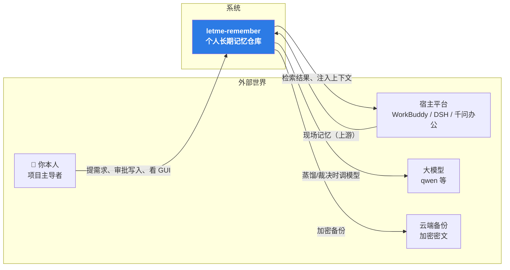
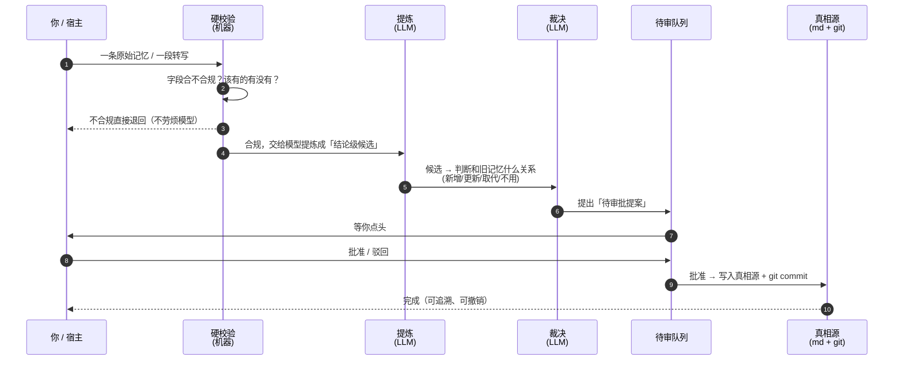
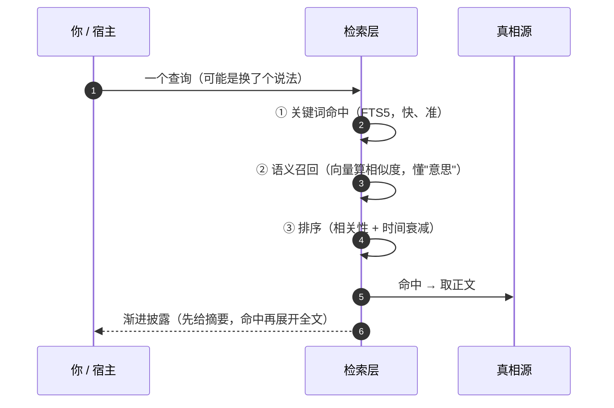

# 项目驾驭地图（Project Map）

> 读者：你自己（项目主导者，PD/PM 视角，不写代码但要能看懂全局）
> 用途：随时回答「系统分几个模块、每个模块干什么、现在什么状态、改这里要验收什么」
> 画法：借鉴 **C4 模型**——先给你看「全局上下文图」，再逐层下钻；标「职责」不标「技术名」。
> 维护规矩：**每改一个模块，就更新对应那一行**。三份文档分工——速查卡讲「为什么这么设计」、需求定稿讲「要做什么」、本图讲「现在什么样、动哪里查什么」。

---

## 0. 一句话定位

letme-remember 是**个人长期记忆仓库**：把散落在 WorkBuddy / DSH / 千问办公等宿主里的「现场记忆」，蒸馏成「结论级记忆」，落到本地 md 真相源 + SQLite 索引，供以后检索复用。

**核心规则：数据单向流动——宿主（上游）→ 蒸馏 → 档案（下游），永不回写上游。**

---

## 1. 系统上下文图（C4 Level 1 · 先看这张，看懂全局）

这张图回答：「这个系统是什么、谁在用、和谁打交道」，**不画内部技术细节**，就是给你这种非技术主导者看的。

**一句话读懂**：记忆从「宿主」（你平时用的工具）流进来 → 系统蒸馏沉淀 → 你随时能搜回来；只有「加密后的密文」才上云，密钥留在本地。

---

## 2. 一条记忆的「写入旅程」（时序图 · 看懂核心流程）

这是整个系统**最核心的一条链路**，看懂了它，就懂了这个系统在干什么：

**三审的职责分工**（记住这句就行）：**机器管「格式对不对」，模型管「内容怎么提」，你管「要不要收」。** 三层谁都不越权。

---

## 3. 模块地图（21 个模块，按五大能力域分组）

> 第一列是**人话名字**（让你秒懂它在干嘛），文件名只是「它在代码里叫啥」，放括号里备查。

### 3.1 写入域（一条记忆怎么进来）

| 能力（人话） | 干什么 | 为什么这么设计 | 状态 | 测试 |
|---|---|---|---|---|
| **硬校验**（`validate.py`） | 写之前检查字段合不合规 | 机器能确定的错误，不劳烦 LLM | ✅ | unit/test_validate |
| **记忆身份证**（`frontmatter.py`） | 每条记忆的封闭格式文件头 | 不用 YAML，自造封闭格式当护栏 | ✅ | unit/test_frontmatter |
| **脱敏**（`redaction.py`） | B 类敏感事实按规则处理 | 敏感事实「可入库+输出分层」，不是删 | ✅ | unit/test_redaction |
| **提案**（`proposal.py`） | 候选 → 待审批提案 | 写入要人点头，AI 不能直写 | ✅ | — |
| **待审队列**（`queue.py`） | 攒着等人批 | 批量写入不绕过审批 | ✅ | integration/test_queue |
| **裁决**（`judgment.py`） | LLM 判断新增/更新/取代/不用 | 新旧记忆的关系，机器判不了 | ✅ | integration/test_llm_judgment |

### 3.2 存储域（记忆存在哪、长什么样）

| 能力（人话） | 干什么 | 为什么这么设计 | 状态 | 测试 |
|---|---|---|---|---|
| **记忆定义**（`schema.py`） | 字段 + 三类型（语义/情景/程序） | 类型收敛，一眼能分 | ✅ | unit/test_schema |
| **真相源读写**（`store.py`） | 读写 md 文件 + 建目录/私有 git | 文件是真相，索引是可重建缓存 | ✅ | integration/test_store |
| **审计日志**（`gitutil.py`） | 用 git 记每次改动 | 可追溯、可 revert | ✅ | unit/test_gitutil |
| **加密备份**（`backup.py`） | 加密 + 同步云端 | 密钥不上云，云端只存密文 | ✅ | integration + e2e/test_backup |
| **中文分词**（`tokenizer.py`） | 拆词用于检索 | 纯 Python 自带词典，无编译依赖 | ✅ | — |

### 3.3 检索域（怎么把记忆找回来）

| 能力（人话） | 干什么 | 为什么这么设计 | 状态 | 测试 |
|---|---|---|---|---|
| **索引与检索**（`index.py`） | 建索引 + 排序 + 检索 | 三层路径，零 LLM | ✅ | integration/test_index |
| **语义向量化**（`embedding.py`） | 把「意思」转成向量算相似度 | 换说法也能搜到 | ✅ | unit(隔离) |
| **模型客户端**（`llm.py`） | 调 LLM 的封装 | 可插拔，模型不可用能降级 | ✅ | (走 mock) |

### 3.4 治理域（记忆的「体检」和「迭代」）

| 能力（人话） | 干什么 | 为什么这么设计 | 状态 | 测试 |
|---|---|---|---|---|
| **蒸馏**（`distill.py`） | 长文本 → 结论级候选 | 一条日志 ≠ 一条结论 | ✅ | integration/test_distill |
| **分块**（`chunk.py`） | 超长文本分块 | 长转写单次蒸馏会截断丢信息 | ✅ v2④ | unit/test_chunk_incremental |
| **增量识别**（`incremental.py`） | 分块合并 + 结论级 diff | 识别「这次比上次深在哪」 | ✅ v2④ | unit/test_chunk_incremental |
| **存量导入**（`importprep.py`） | 旧记忆预处理分类 | 只读源、不搬运、不批量直写 | ✅ | unit+integration/test_importprep |
| **宿主接入**（`host/`） | 各宿主读写适配 | 多宿主都能写，单向流动 | ✅ | integration/test_host |

### 3.5 观测域（系统健康红绿灯）

| 能力（人话） | 干什么 | 为什么这么设计 | 状态 | 测试 |
|---|---|---|---|---|
| **只读控制台**（`gui_server.py`） | 记忆控制台后端 | 复用现有模块读真数据 | ✅ v2⑤ | — |
| **常驻服务**（`serve.py`） | 两段式披露 + 语义召回 | 会话级自动拉起/关闭 | ✅ | — |
| **命令行入口**（`cli.py`） | 所有命令的调度中枢 | 单一入口，退出码约定 | ✅ | e2e/test_cli_e2e |

---

## 4. 检索旅程（时序图 · 看懂「搜」怎么工作）

**一句话读懂**：搜索分三层——先靠「关键词」精准命中，再靠「语义向量」补上「换了个说法但意思一样」的情况，最后排序。找不到不报错，只是返回空。

---

## 5. 大版本迭代清单（过去做了什么 · 未来做什么）

### 已发布（历史，每个版本拆到「一句话一件事」）

**v1.0 — 核心闭环**（把系统「跑起来、能用」）
- 定下「md 文件是唯一真相源，索引是可重建缓存」这个根本前提
- 实现写入链：硬校验 → 提案 → 人审批，AI 不能直写
- 实现检索：FTS5 关键词 + 排序公式，零 LLM 依赖
- 定下「三类型」记忆模型（语义/情景/程序，对齐 CoALA，放弃旧九类）
- 搭好命令行接口 + 退出码约定 + 端到端验收
- 补「真删除」机制（purge），区分「过时结论」和「错误记忆」

**v1.1 — LLM 软判断**（让模型参与「判断」，而不是只存）
- 接入可插拔 LLM 客户端（OpenAI 兼容），模型不可用时能降级
- 第二审裁决：判断候选和旧记忆是「新增/更新/取代/不用」四操作
- 冲突检测增强：检索相似结论喂 LLM 比对
- 批量蒸馏：把旧日志批量提炼成「结论级候选」
- 蒸馏加克制原则（宁缺毋滥、合并碎片），防输出失控
- 自动去重合并（consolidate），支持分批、dry-run
- reference 路径回填：LLM 不猜路径，代码从真实文件系统回填（回填率 9%→64%）

**v1.2 — 无感集成 + 加密备份**（让记忆「自动进来、安全出去」）
- 宿主无感集成层（WorkBuddy 优先），多宿主都能写
- 待审队列：蒸馏候选异步入库审批
- 加密备份与恢复：密钥不上云，云端只存密文
- 云端同步固化（加密 → push → clone → 恢复全链路）

**v1.3 — 语义检索 + 存量导入**（让记忆「换说法也能搜到、旧数据能进来」）
- 本地语义检索（embedding 向量召回）+ 两段式渐进披露
- 常驻召回服务：模型只加载一次，检索毫秒级
- 存量导入只读预处理：旧记忆分类「可转/待裁决/排除」，候选暂存、脱敏报告

### v2.0 方向（按既定排序推进）

| 序 | 方向 | 解决什么痛点 | 状态 |
|---|---|---|---|
| ⑤ | 日志+观测+GUI | 看不到系统健康状态、点进去看不到详情 | ✅ 已完成 |
| ④ | 蒸馏分块+增量 | 长转写截断丢信息、识别不了「这次深在哪」 | ✅ 已完成 |
| ① | 合并多维 | 取代时只留一条，丢失历史多维信息 | 🔜 **下一个** |
| ② | 跨平台仲裁 | 多宿主写同一结论，谁对谁错没仲裁 | ⏳ 未做 |
| ③ | 重要度 | 记忆没有权重，检索时重要的排不到前面 | ⏳ 未做 |
| ⑥ | 密钥冗余 | 本地密钥+本地记忆双丢=永久解不开 | ⏳ 未做 |

### 挂起（已定方向、未定实现）

- **输出策略层**：敏感事实「多口径」怎么存、怎么按人/场景选（D1 关键扩展，重点）
- **fork 与否**：先借鉴 agent-memory 不 fork，看清差异再定
- **语义红线**：入库审批的具体实现（独立审查 or 并入第二审）

### 待办（已记入 WorkBuddy 任务，等能力落地再做）

- 健康四维补全（唯一性去重 + 隐性矛盾检测）
- 黄金信号补埋点（错误 + 时延）
- GUI 写操作（编辑/删除/取代/归档）
- Honeypot 观测层、全量入库时间线、密钥冗余备份
- 引入 SpecGate 需求门禁（桥接 OpenSpec，验「需求能不能被验证」，与现有准出闸门互补）

---

## 6. 改动验收指南（改哪里，查什么）

> 给你验收 AI 改动用的检查清单：AI 说「改好了」，按这表核对它动了哪些、该跑哪些测试、该更新哪些文档。

| 改了哪个能力域 | 该跑哪些测试 | 该更新哪些文档 |
|---|---|---|
| 存储（记忆定义/真相源/审计/备份/分词） | unit/test_schema、frontmatter、gitutil；integration/test_store、backup | 速查卡 §2/§4 + 本图 §3.2 |
| 检索（索引/语义/模型客户端） | integration/test_index | 速查卡 §6 + 本图 §3.3 |
| 写入（校验/脱敏/提案/队列/裁决） | unit/test_validate、redaction；integration/test_queue、llm_judgment | 速查卡 §5 + 本图 §3.1 |
| 治理（蒸馏/分块/增量/导入/宿主） | unit/test_chunk_incremental、importprep；integration/test_distill、importprep | 速查卡 §10 + 本图 §3.4 |
| 观测（控制台/服务/命令行） | e2e/test_cli_e2e、test_acceptance_journey | 速查卡 §13 + 本图 §3.5 |

**任何改动后必做**：跑 `python tools/gate.py`（7 项闸门），全绿才算准出。改动若涉及「设计取舍」，同步更新速查卡 + 需求定稿 + 本图。

---

## 7. 我怎么用这份地图

1. **接手项目 / 隔段时间回来看**：先看 §1 全局图（30 秒看懂）→ §2 写入时序图（看懂核心流程）→ §5 版本清单（知道进行到哪）。
2. **AI 说「做完了 XX」**：对照 §6 检查它跑了哪些测试、更新了哪些文档、gate 绿不绿。
3. **要启动下一个方向**：看 §5 的 v2.0 排序，直接说「做①」即可。
4. **有模块看不懂**：回速查卡（design-tradeoffs-cheatsheet.md）对应章节看「为什么这么设计」。

---

*最后更新：2026-11-15 ｜ 最近改动：准出闸门修复、蒸馏分块落地、地图加时序图与版本清单、版本清单拆细*
